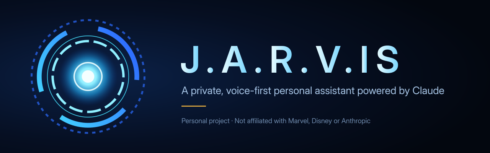
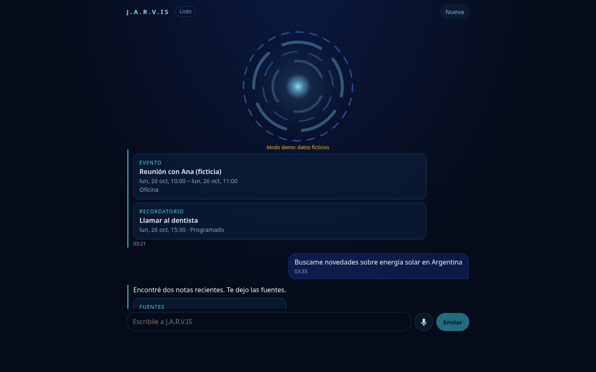
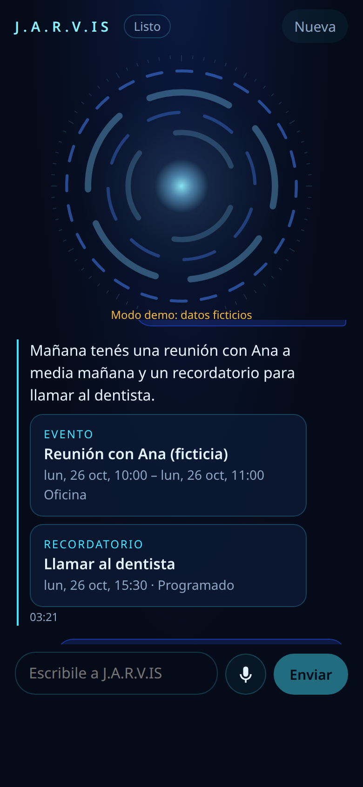

<p align="center">
  
</p>

# J.A.R.V.IS

A private, voice-first personal assistant powered by Claude, with conversational memory, messaging integrations, reminders, and a cinematic web interface.

The interface is a single conversation, by text or voice. There are no dashboards: you ask "¿Qué tengo mañana?", "¿Qué dijo Fran del partido?" or "Recordame pagar esto el viernes" and the assistant uses its tools to answer. It is built for exactly one owner, runs entirely in the cloud, and is designed to later drive a small Wi-Fi speaker (M5Stack ATOM Echo).

> Personal project. Not affiliated with Marvel, Disney or Anthropic. The code is public; any deployment requires authentication and holds the owner's data privately.

## Status

Status vocabulary: *implemented*, *tested with fixtures*, *validated with real service*, *pending owner connection*, *pending hardware*.

| Area | Status |
| - | - |
| Claude runtime via the official Agent SDK on the owner's subscription | validated with real service (local login), see [docs/claude-runtime.md](docs/claude-runtime.md) |
| Sessions resumed by explicit id, cancellation, quota and auth errors | validated with real service; quota paths tested with fixtures |
| Memory with provenance, audit trail and forgetting | tested with fixtures |
| Backend tool policy (allowlist, confirmations after untrusted content, idempotent writes) | tested with fixtures |
| WebSocket protocol, owner login, origin checks | tested with fixtures |
| Agenda, agreements, contacts, reminders worker with outbox | tested with fixtures; worker validated in Docker |
| Web Push (VAPID, discreet notifications) | tested with fixtures; pending owner connection (keys and a device) |
| Gmail read-only, personal and work accounts kept separate | tested with fixtures; pending owner connection |
| WhatsApp: export import and experimental read-only Baileys bridge | tested with fixtures; pending owner pairing |
| YouTube search and in-chat player | tested with fixtures; player validated in Chrome (demo mode) |
| Voice: sentence-streamed TTS, STT, robotic effect, interruption | tested with fixtures; Piper and faster-whisper validated locally; Groq/ElevenLabs pending owner keys |
| Conversational PWA with animated core | validated in Chrome against the local server; Safari/iPhone pending hardware |
| Docker, Caddy TLS, encrypted backups with restore test, CI | tested locally and in CI; real VPS, domain and bucket pending owner |
| Device gateway, simulator and ATOM Echo firmware | in progress, pending hardware |

## Screenshots

Demo mode with fictitious data (`?demo`).

<p align="center">
  
  
</p>

## Architecture

```
 Browser PWA ─┐                         ┌─ Claude Code (Agent SDK subprocess, owner's subscription)
              │ WSS /ws  (cookie)        │      └─ in-process MCP server "jarvis" (per turn)
 ESP32 device ┤ WSS /ws/device (token)   │
              ▼                          │
          Caddy (TLS) ──► server (Fastify) ──► SQLite (WAL, FTS5)  ◄── worker (reminders, outbox, Web Push)
                               │                                   ◄── whatsapp-bridge (optional)
                               ├─► STT provider (swappable)
                               └─► TTS provider (swappable)
```

- **Monorepo** (pnpm, Node 24, TypeScript): `packages/contracts` (shared zod schemas), `apps/server` (Fastify, SQLite, Agent SDK), `apps/web` (React + Vite PWA).
- **One SQLite database** (WAL, FTS5) is the source of truth for conversations, memories, agenda, agreements, reminders and messages. Claude session files are only a resumable cache.
- **Claude** runs as the unmodified Claude Code binary through the Agent SDK, authenticated with the owner's subscription. Each turn gets a strict allowlist of tools served by an in-process MCP server; no shell, no filesystem, no web fetch.
- **Reminders** are delivered by an independent worker with an outbox, so they keep working when Claude is unavailable or out of quota.

Details: [docs/architecture.md](docs/architecture.md).

## Setup

A step-by-step installation guide in Spanish is in [docs/setup.es.md](docs/setup.es.md); deployment details are in [docs/deploy.md](docs/deploy.md) and operations in [docs/runbook.md](docs/runbook.md). Development quick start:

```bash
nvm use 24
pnpm install
cd apps/server && pnpm -s hash-password   # prints an scrypt hash for OWNER_PASSWORD_HASH
RUNTIME=scripted OWNER_PASSWORD_HASH='<hash>' DATA_DIR=../../data pnpm dev
pnpm check                                 # lint, typecheck, tests, build
```

`RUNTIME=scripted` uses a deterministic fixture instead of Claude. With `RUNTIME=claude` (default) the server uses your local Claude Code login, or `CLAUDE_CODE_OAUTH_TOKEN` from `claude setup-token` on a server.

## Costs and limitations

Estimates from official price pages retrieved on 2026-10-24 ([docs/costs.md](docs/costs.md)); they are not quotes and exclude taxes.

| Turns per day | Server (2 vCPU / 2 GB, São Paulo) | Voice (Groq STT + ElevenLabs Flash) | Backups + domain | Total |
| - | - | - | - | - |
| 10 | USD 12.00 | USD 2.19 | USD 0.93 | ~USD 15 / month |
| 30 | USD 12.00 | USD 6.58 | USD 0.93 | ~USD 20 / month |
| 60 | USD 12.00 | USD 13.16 | USD 0.94 | ~USD 26 / month |

- Claude is the owner's existing subscription. Its limits are shared with the owner's own Claude usage and are not a guaranteed number of queries; when the quota runs out the assistant says so and reminders keep working. Paid overage is refused unless explicitly enabled.
- A cheaper Hetzner server lowers the totals by about USD 4.5 at the cost of higher latency from Buenos Aires; local Piper + faster-whisper removes the voice line but needs a larger server.
- Measured latency (Claude only, Sonnet 5.5): first text p50 ≈ 2.1 s for simple turns, ≈ 4.3 s with one tool call. End-to-end voice latency adds STT and TTS and is recorded per turn.
- WhatsApp access is unofficial and may get the number restricted; history coverage is partial and always reported. Push delivery and background listening are not guaranteed on iPhone.

## Privacy

- Single owner. Password login with server-side sessions; anonymous access is rejected.
- Emails, chats and web pages are treated as untrusted data. After a turn reads them, any change to memory, agenda or reminders needs the owner's explicit confirmation in the UI, enforced in the backend.
- OAuth tokens stay inside adapters, encrypted at rest with a separate key, and never reach the model's context.
- Message bodies, audio and tokens are not logged. Raw audio is not stored after transcription.
- The repository never contains the real profile (`loren.md`), databases, sessions, recordings, voice datasets or weights. Only `assistant/loren.example.md` with fictitious data is public.

## Roadmap

1. Chat with Claude, memory and persistent sessions.
2. Two-way voice, personality, follow-up listening and interruption.
3. Gmail, WhatsApp, agenda, agreements and reminders.
4. Animated PWA, notifications and YouTube.
5. Deployment, backups, recovery, costs and real-service tests.
6. Physical device.

## Contributing and security

See [CONTRIBUTING.md](CONTRIBUTING.md). Security reports: see `SECURITY.md`.

## License and attributions

MIT, see [LICENSE](LICENSE). Brand assets are original work, see [assets/brand/README.md](assets/brand/README.md). "Claude" is a trademark of Anthropic; this project only states that it uses Claude. JARVIS is a character owned by Marvel; this project is an unaffiliated personal homage.
