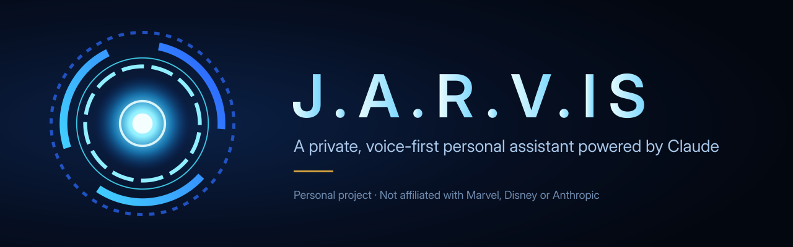
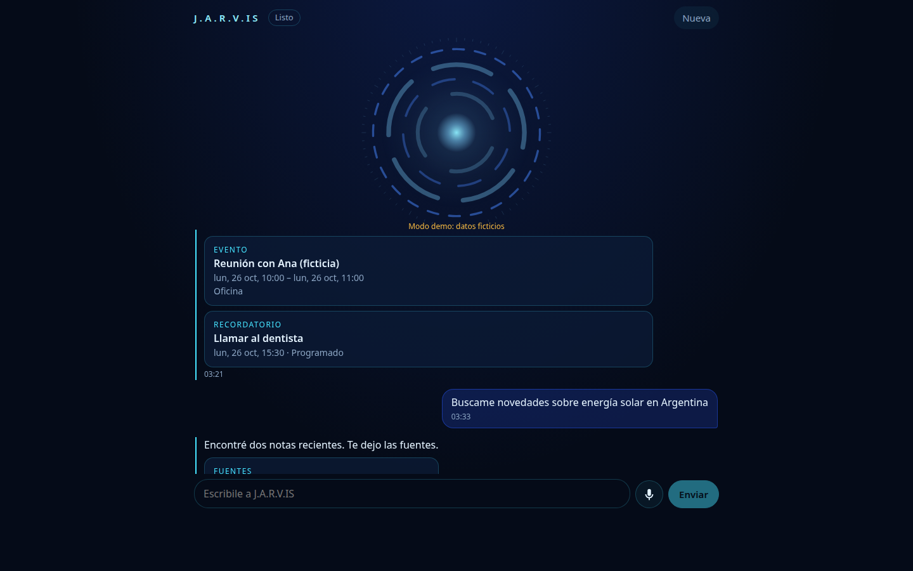
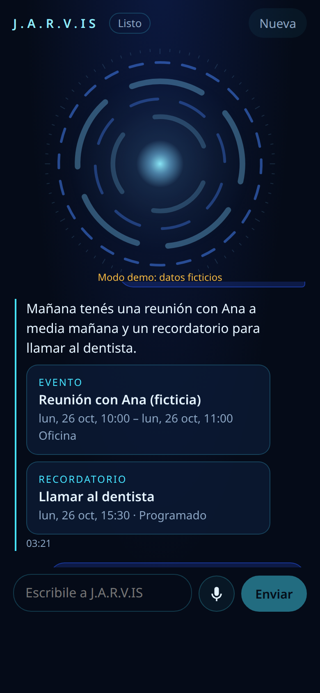

<p align="center">
  
</p>

# J.A.R.V.IS

A private, voice-first personal assistant powered by Claude, with conversational memory, messaging integrations, reminders, a cinematic web interface, and a control point for work tasks done by background agents.

The interface is a single conversation, by text or voice. There are no dashboards. You can:

- ask "¿Qué tengo mañana?" or "¿Qué dijo Fran del partido?";
- ask for "Recordame pagar esto el viernes";
- hand over work with "Revisá esta tarea de la empresa y resolvela", then ask "¿Cómo viene?" and "Mostrame el resultado".

Quick questions are answered in the conversation. Work is registered as a task: background agents plan it, execute it and review it with evidence, and you get a card to approve or send back.

It is built for exactly one owner, runs on a single server, and is designed to later drive a desk voice terminal (ReSpeaker XVF3800 in a 3D-printed ARC enclosure).

> Personal project. Not affiliated with Marvel, Disney or Anthropic. The code is public; any deployment requires authentication and holds the owner's data privately.

## Status

Status vocabulary: *implemented*, *tested with fixtures*, *validated with real service*, *pending owner connection*, *pending hardware*.

| Area | Status |
| - | - |
| Claude runtime via the official Agent SDK on the owner's subscription | validated with real service (local login), see [docs/claude-runtime.md](docs/claude-runtime.md) |
| Sessions resumed by explicit id, cancellation, quota and auth errors | validated with real service; quota paths tested with fixtures |
| Memory with provenance, audit trail and forgetting | tested with fixtures |
| Backend tool policy (allowlist, confirmations after untrusted content, idempotent writes) | tested with fixtures |
| WebSocket protocol, owner login, origin checks | tested with fixtures |
| Agenda, agreements, contacts, reminders worker with outbox | tested with fixtures; worker validated in Docker |
| Web Push (VAPID, discreet notifications) | tested with fixtures; pending owner connection (keys and a device) |
| Gmail read-only, personal and work accounts kept separate | tested with fixtures; pending owner connection |
| WhatsApp: export import and experimental read-only Baileys bridge | tested with fixtures; pending owner pairing |
| YouTube search and in-chat player | tested with fixtures; player validated in Chrome (demo mode) |
| Voice: sentence-streamed TTS, STT, robotic effect, interruption | tested with fixtures; Piper and faster-whisper validated locally; Groq key and the ElevenLabs instant clone validated with real service (samples generated with the production engine) |
| Conversational PWA with animated core | validated in Chrome against the local server; Safari/iPhone pending hardware |
| Docker, Caddy TLS, encrypted backups with restore test, CI | validated with real service: Lightsail São Paulo, Let's Encrypt, restic to R2 with a test restore |
| Device gateway with revocable tokens, simulator | tested with fixtures; simulator validated against the server |
| ATOM Echo firmware (PlatformIO, push-to-talk) | compiles; pending hardware |
| End-to-end voice turn with real Claude and local STT/TTS | validated with real service (first audio 4.7 s; see [docs/voice.md](docs/voice.md)) |
| Acceptance tests (18) with evidence | see [docs/qa/acceptance.md](docs/qa/acceptance.md) |
| Delegated work: task tools, runner (plan, execute, independent review), limits, recovery, approvals, notifications, attachments | tested with fixtures (scripted agents and a controlled task checked by running code), see [docs/agents.md](docs/agents.md) |
| Delegated work with real Claude agents (Haiku 5.5 planner, Sonnet 5.5 executor and reviewer, on the subscription) | validated with real service on the VPS, with Bash in the sandbox and the runner as a host service |
| Call mode, hold-to-record voice notes, speaker toggle, HUD core, chart and table cards | tested with fixtures; deployed, pending the owner's first use on the iPhone |

## Screenshots

Demo mode with fictitious data (`?demo`).

<p align="center">
  
  
</p>

## Architecture

```
 Browser PWA ─┐                         ┌─ Claude Code (Agent SDK subprocess, owner's subscription)
              │ WSS /ws  (cookie)        │      └─ in-process MCP server "jarvis" (per turn, incl. task_* tools)
 ESP32 device ┤ WSS /ws/device (token)   │
              ▼                          │
          Caddy (TLS) ──► server (Fastify) ──► jarvis.db (personal)  ◄── worker (reminders, outbox, Web Push,
                               │      │                                        task notifications)
                               │      └──────► work.db (tasks) ◄──────────── agent-runner (separate container)
                               ├─► STT provider (swappable)                     └─ plan → execute → review
                               └─► TTS provider (swappable)                        (Haiku / Sonnet, subscription)
```

- **Monorepo** (pnpm, Node 24, TypeScript): `packages/contracts` (shared zod schemas), `apps/server` (Fastify, SQLite, Agent SDK), `apps/web` (React + Vite PWA).
- **SQLite** (WAL, FTS5).
  - `jarvis.db` is the source of truth for conversations, memories, agenda, agreements, reminders and messages.
  - `work.db` holds delegated tasks on its own volume. The agents' container mounts only that volume.
  - Claude session files are only a resumable cache.
- **Claude** runs as the unmodified Claude Code binary through the Agent SDK, authenticated with the owner's subscription. Each turn gets a strict allowlist of tools served by an in-process MCP server; no shell, no filesystem, no web fetch.
- **Reminders** are delivered by an independent worker with an outbox, so they keep working when Claude is unavailable or out of quota.
- **Delegated work** runs in a separate `agent-runner` container with its own database (`work.db`), volume and Claude credentials.
  - Each task goes through a planner (Haiku), an executor and an independent reviewer (Sonnet), with budgets, a plan reserve, leases and recovery owned by code.
  - Nothing an agent finishes is published or deployed without an explicit tap from the owner.

Details: [docs/architecture.md](docs/architecture.md) and [docs/agents.md](docs/agents.md). The plan as of 2026-11-20, with what changed and why: [docs/plan.es.md](docs/plan.es.md).

## Setup

A step-by-step installation guide in Spanish is in [docs/setup.es.md](docs/setup.es.md); deployment details are in [docs/deploy.md](docs/deploy.md) and operations in [docs/runbook.md](docs/runbook.md). Development quick start:

```bash
nvm use 24
pnpm install
cd apps/server && pnpm -s hash-password   # prints an scrypt hash for OWNER_PASSWORD_HASH
RUNTIME=scripted OWNER_PASSWORD_HASH='<hash>' DATA_DIR=../../data pnpm dev
pnpm check                                 # lint, typecheck, tests, build
```

`RUNTIME=scripted` uses a deterministic fixture instead of Claude. With `RUNTIME=claude` (default) the server uses your local Claude Code login, or `CLAUDE_CODE_OAUTH_TOKEN` from `claude setup-token` on a server.

## Costs and limitations

Estimates from official price pages; they are not quotes and exclude taxes. The full breakdown, re-checked on 2026-11-20 with delegated work included, is in [docs/costs.md](docs/costs.md).

| Turns per day | Server (Lightsail São Paulo 4 GB) | Voice (Groq STT + ElevenLabs Flash) | Backups + domain | Claude Max | Total |
| - | - | - | - | - | - |
| 10 | USD 24.00 | USD 2.19 | USD 0 | USD 100 | ~USD 126 / month |
| 60 | USD 24.00 | USD 13.16 | USD 0 | USD 100 | ~USD 137 / month |

- **Claude Max.** The chat and the background agents both run on the subscription, with separate tokens and no API key. Agents stop starting work once any plan window passes 70 % and wait for the reset, so the chat keeps the rest. Paid extra usage stays off.
- **Limits.** Subscription limits are shared with the owner's own Claude usage and are not a guaranteed number of queries. When the quota runs out the assistant says so, and reminders keep working. Paid overage is refused unless explicitly enabled.
- **Cheaper server.** Hetzner CX33 (Europe) cuts about USD 14 per month, with higher chat latency from Buenos Aires.
- **Measured latency** (Claude only, Sonnet 5.5): first text p50 ≈ 2.1 s for simple turns, ≈ 4.3 s with one tool call.
- **Known caveats.**
  - WhatsApp access is unofficial and may get the number restricted; history coverage is partial and always reported.
  - Push delivery and background listening are not guaranteed on iPhone.

## Privacy

- Single owner. Password login with server-side sessions; anonymous access is rejected.
- Emails, chats and web pages are treated as untrusted data. After a turn reads them, any change to memory, agenda or reminders needs the owner's explicit confirmation in the UI, enforced in the backend.
- OAuth tokens stay inside adapters, encrypted at rest with a separate key, and never reach the model's context.
- Message bodies, audio and tokens are not logged. Raw audio is not stored after transcription.
- The repository never contains the real profile (`loren.md`), databases, sessions, recordings, voice datasets or weights. Only `assistant/loren.example.md` with fictitious data is public.

## Roadmap

Done:

1. Chat with Claude, memory and persistent sessions.
2. Two-way voice, personality, follow-up listening and interruption.
3. Gmail, WhatsApp, agenda, agreements and reminders.
4. Animated PWA, notifications and YouTube.
5. Deployment, backups, recovery, costs and real-service tests.
6. Delegated work tasks with independent review (first version).

Next, from [docs/plan.es.md](docs/plan.es.md):

- deploy on a 4 GB server with Claude Max and verify the agent sandbox there;
- run the first real work tasks;
- integrate the company's own task app once its access is known;
- phone actions, WhatsApp alerts and Instagram;
- the voice terminal.

## Contributing and security

See [CONTRIBUTING.md](CONTRIBUTING.md). Security reports: see `SECURITY.md`.

## License and attributions

MIT, see [LICENSE](LICENSE). Brand assets are original work, see [assets/brand/README.md](assets/brand/README.md). "Claude" is a trademark of Anthropic; this project only states that it uses Claude. JARVIS is a character owned by Marvel; this project is an unaffiliated personal homage.
